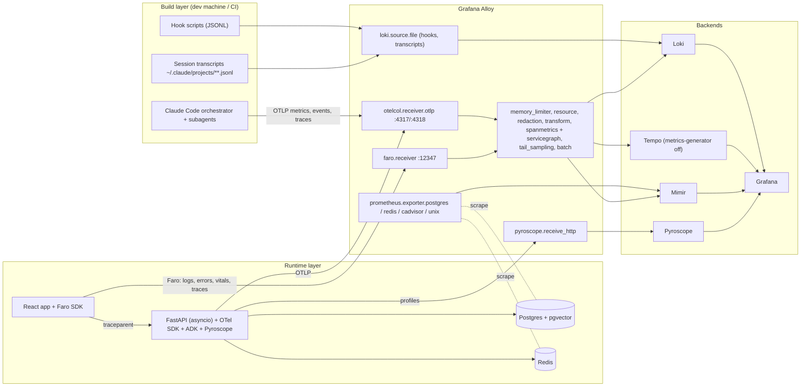

# Observability Platform Spec: Agent-Built, Agent-Powered App

Version 0.1 (design only, no code) · Scope: one project now, multi-project later

## 1. Goals and non-goals

### Goals

1. Capture all the telemetry that is available from two layers:
   - **Build layer**: Claude Code orchestrating a team of subagents that write the app.
   - **Runtime layer**: the app itself. That means the React frontend, the async FastAPI backend, the ADK agents inside it, Postgres (app data plus embeddings) and Redis.
2. Send logs, metrics, traces and profiles through one collector (Grafana Alloy) into one backend (LGTM, plus Pyroscope for profiles).
3. Correlate everything. Any signal should link to the trace, session, conversation, commit and agent that produced it.
4. Join the two layers. A runtime regression should be traceable back to the agent-built commit that introduced it.
5. Make the multi-project move a config change, not a rewrite.

### Non-goals (for v0.1)

- LLM evaluation as a product (no LLM-as-judge pipeline). Section 7.5 only reserves the hooks and signal names for it.
- Anything Grafana Cloud-specific. Everything is self-hosted OSS, but Grafana Cloud stays a drop-in swap at the Alloy exporter layer.
- Billing-grade cost accounting. All cost figures here are estimates.

## 2. Assumptions to challenge

| Assumption | Pushback | Decision |
|---|---|---|
| "Collect every metric possible" | Collecting broadly is cheap. Indexing broadly is not. The real risk is high-cardinality labels (session IDs, trace IDs, user IDs) leaking into Mimir or Loki index labels, not the volume of data. | Collect everything. Index only a small, fixed label set (section 9). Everything else goes into span attributes or Loki structured metadata. |
| Mimir for one project | Plain Prometheus is simpler for one project. | Keep Mimir in monolithic mode. You said "maybe later not", and Mimir's native OTLP endpoint and multi-tenancy make that move cheaper. |
| `grafana/otel-lgtm` as the stack | That image is for dev, demo and testing only ([Grafana docs](https://grafana.com/docs/opentelemetry/docker-lgtm/)). It also ships an OTel Collector, not Alloy. | Use discrete containers (Alloy, Loki, Tempo, Mimir, Pyroscope, Grafana) from day one. |
| Claude Code costs are "the cost" | Cost and token metrics are approximations calculated locally at list price ([Claude Code docs](https://code.claude.com/docs/en/monitoring-usage)). They don't reflect subscription billing ([Claude Code costs](https://code.claude.com/docs/en/costs)). | Label build-layer cost as "estimated, list price" on every panel. |
| One trace per Claude Code build session | Every user prompt starts its own `claude_code.interaction` root span. Interactive CLI sessions ignore an inbound `TRACEPARENT`; only Agent SDK and `claude -p` runs honor it ([Claude Code monitoring](https://code.claude.com/docs/en/monitoring-usage)). | Group by `session.id`. If you want a single parent trace per build run, drive the orchestrator through `claude -p` or the Agent SDK (section 5.4). |
| ADK is safe by default | ADK's legacy spans capture prompts, model replies, tool args and tool results by default ([ADK telemetry config](https://github.com/google/adk-python/blob/main/docs/guides/telemetry/telemetry_config/index.md)). There is also an open issue where OAuth tokens and client secrets leak into `execute_tool` span attributes ([ADK issue #7311](https://github.com/google/adk-python/issues/7311)). | Content capture is an explicit per-environment policy (section 10), enforced in Alloy as well. |

## 3. Architecture



### Component choices

| Concern | Choice | Notes |
|---|---|---|
| Collector | Grafana Alloy | One process handles OTLP, Faro, file tailing, embedded Prometheus exporters and profile forwarding. |
| OTLP ingest | `otelcol.receiver.otlp` (gRPC 4317, HTTP 4318) | Receives metrics, logs and traces ([Alloy docs](https://grafana.com/docs/alloy/latest/collect/opentelemetry-data/)). |
| Frontend ingest | `faro.receiver` (stable) | Built-in CORS, API key, per-app rate limiting and sourcemap download ([faro.receiver](https://grafana.com/docs/alloy/latest/reference/components/faro/faro.receiver/)). `otelcol.receiver.faro` is public preview ([otelcol.receiver.faro](https://grafana.com/docs/alloy/latest/reference/components/otelcol/otelcol.receiver.faro/)), so don't use it in v0.1. |
| Logs | Loki 3.x, native OTLP at `/otlp` | Requires `allow_structured_metadata: true` ([Loki OTLP docs](https://grafana.com/docs/loki/latest/send-data/otel/)). |
| Traces | Tempo | Alloy generates the RED and service-graph metrics (section 4.3), so Tempo's metrics-generator stays off. |
| Metrics | Mimir, monolithic, OTLP at `/otlp` | Enable native histograms so OTel exponential histograms are accepted ([Mimir OTLP docs](https://grafana.com/docs/mimir/latest/configure/configure-otel-collector/)). |
| Profiles | Pyroscope, plus `pyroscope-otel` span profiles | Span profiles are CPU-only ([Pyroscope Python span profiles](https://grafana.com/docs/pyroscope/latest/configure-client/trace-span-profiles/python-span-profiles/)). |
| Visualization and alerting | Grafana, with dashboards and alerts provisioned as code | |
| Object storage | MinIO (single node) or local filesystem in dev | Loki, Tempo, Mimir and Pyroscope share one bucket with separate prefixes. |
| Deployment | Docker Compose: `observability` profile next to the app's compose file | Moving to Kubernetes or Grafana Cloud later means changing Alloy exporters only. |

## 4. Alloy pipeline spec

### 4.1 Inputs

| ID | Component | Source | Signals |
|---|---|---|---|
| IN-1 | `otelcol.receiver.otlp` | Claude Code, FastAPI/ADK, CI test runs | metrics, logs, traces |
| IN-2 | `faro.receiver` | React app | logs (errors, events, vitals, measurements), traces |
| IN-3 | `loki.source.file` | `~/.claude/telemetry/hooks/*.jsonl` | logs |
| IN-4 | `loki.source.file` | `~/.claude/projects/**/*.jsonl` (session transcripts) | logs |
| IN-5 | `loki.source.docker` | Container stdout/stderr (Postgres, Redis, app fallback) | logs |
| IN-6 | `prometheus.exporter.postgres` | Postgres | metrics ([component docs](https://grafana.com/docs/alloy/latest/reference/components/prometheus/prometheus.exporter.postgres/)) |
| IN-7 | `prometheus.exporter.redis` | Redis | metrics ([component docs](https://grafana.com/docs/alloy/latest/reference/components/prometheus/prometheus.exporter.redis/)) |
| IN-8 | `prometheus.exporter.cadvisor`, `prometheus.exporter.unix` | Docker host | container and host metrics |
| IN-9 | `pyroscope.receive_http` | FastAPI Pyroscope SDK | profiles ([component docs](https://grafana.com/docs/alloy/latest/reference/components/pyroscope/pyroscope.receive_http/)) |
| IN-10 | `prometheus.scrape` (self) | Alloy, Loki, Tempo, Mimir, Pyroscope | meta-monitoring |

### 4.2 Processing order (OTLP and Faro paths)

1. `otelcol.processor.memory_limiter` (backpressure guard).
2. `otelcol.processor.resourcedetection` and `otelcol.processor.attributes`. Stamp `service.namespace`, `deployment.environment.name` and `app.layer` (`build` or `runtime`) when they are missing.
3. **Redaction** with `otelcol.processor.transform` and `otelcol.processor.redaction`:
   - Hash-allowlist known secret keys: `access_token`, `refresh_token`, `client_secret`, `authorization`, `api_key`, `password`.
   - Regex-mask bearer tokens, JWTs, `sk-*`/`AIza*` keys and Postgres DSNs in every string attribute and log body.
   - In `prod`, drop `gen_ai.input.messages`, `gen_ai.output.messages`, `gcp.vertex.agent.llm_request`/`llm_response`, `tool_call_args`, `tool_response`, Claude Code `user_prompt`, `full_command` and `tool.output` events.
4. **Metric label hygiene** with `otelcol.processor.transform` on the metrics pipeline. Drop `session.id`, `prompt.id`, `user.account_uuid`, `user.email` and `client_request_id` from metric datapoints. These stay on spans and logs.
5. **Delta to cumulative.** Claude Code defaults to delta temporality ([Claude Code monitoring](https://code.claude.com/docs/en/monitoring-usage)). Either set `OTEL_EXPORTER_OTLP_METRICS_TEMPORALITY_PREFERENCE=cumulative` in Claude Code (preferred), or add `otelcol.processor.deltatocumulative`.
6. **RED from traces** (before sampling, so the numbers stay exact): `otelcol.connector.spanmetrics` and `otelcol.connector.servicegraph`.
   - Spanmetrics default dimensions are `service.name`, `span.name`, `span.kind`, `status.code` ([spanmetrics docs](https://grafana.com/docs/alloy/latest/reference/components/otelcol/otelcol.connector.spanmetrics/)).
   - Add these dimensions: `http.route`, `http.response.status_code`, `gen_ai.operation.name`, `gen_ai.agent.name`, `gen_ai.tool.name`, `gen_ai.request.model`, `db.system.name`, `db.operation.name`.
   - Never add `url.full`, `db.query.text` or any ID as a dimension.
   - Enable exemplars.
7. **Tail sampling** with `otelcol.processor.tail_sampling`, applied to the runtime layer only:
   - `dev`/`ci`: keep 100%.
   - `prod`: keep 100% of errors, 100% of traces over 2 s, 100% of traces with any `invoke_agent` span, and 10% of the rest.
   - Build layer: always 100% (low volume, high value).
8. `otelcol.processor.batch`.

### 4.3 Outputs

| Signal | Exporter | Target |
|---|---|---|
| Traces | `otelcol.exporter.otlp` | Tempo :4317 |
| Metrics | `otelcol.exporter.otlphttp` | Mimir `/otlp` |
| Logs | `otelcol.exporter.otlphttp` | Loki `/otlp` |
| Prometheus exporters | `prometheus.remote_write` | Mimir |
| File/Docker logs | `loki.write` | Loki |
| Profiles | `pyroscope.write` | Pyroscope |

## 5. Build layer: Claude Code and its subagent team

### 5.1 Data sources (use all four)

| Source | What it gives you that the others don't |
|---|---|
| **OTel metrics** | Aggregates for cost, tokens (input, output, cacheRead, cacheCreation), sessions, LOC, commits, PRs, active time and edit accept/reject. They're attributed by `model`, `query_source` (main, subagent, auxiliary), `effort`, `speed`, `agent.name`, `skill.name`, `plugin.name`, `mcp_server.name` and `mcp_tool.name` ([Claude Code monitoring](https://code.claude.com/docs/en/monitoring-usage)). |
| **OTel events → Loki** | Per-request records: `api_request` (cost, duration, full token breakdown, 5-minute vs 1-hour cache writes), `tool_result` (duration, success, input/output sizes), `tool_decision`, `subagent_completed`, `compaction` (tokens before and after), `api_error`, `api_retries_exhausted`, `api_refusal`, `safety_event`, `skill_activated`, `hook_execution_complete`, `mcp_server_connection` and more ([Claude Code monitoring](https://code.claude.com/docs/en/monitoring-usage)). |
| **OTel traces (beta) → Tempo** | The structural view: `claude_code.interaction` → `llm_request` / `tool` → `tool.blocked_on_user` / `tool.execution`, with subagent spans nested under the spawning tool span. `llm_request` carries `ttft_ms`, `stop_reason`, `attempt`, `agent_id` and `parent_agent_id` ([Claude Code monitoring](https://code.claude.com/docs/en/monitoring-usage)). |
| **Hooks + transcripts → Loki** | Things OTel doesn't emit: `SubagentStart`/`SubagentStop` with `agent_transcript_path`, `TaskCreated`/`TaskCompleted`, `TeammateIdle`, `PermissionDenied`, `PostToolBatch` and `InstructionsLoaded` ([Claude Code hooks](https://code.claude.com/docs/en/hooks)). Transcripts are a backfill and audit source. |

### 5.2 Claude Code configuration (env, set in `~/.claude/settings.json` or managed settings)

Claude Code ignores OTel exporter variables in a repository's `.claude/settings.json`. They must live in user settings, managed settings or the shell ([Claude Code monitoring](https://code.claude.com/docs/en/monitoring-usage)).

| Variable | Value | Why |
|---|---|---|
| `CLAUDE_CODE_ENABLE_TELEMETRY` | `1` | Master switch. |
| `CLAUDE_CODE_ENHANCED_TELEMETRY_BETA` | `1` | Traces. |
| `OTEL_METRICS_EXPORTER` / `OTEL_LOGS_EXPORTER` / `OTEL_TRACES_EXPORTER` | `otlp` | |
| `OTEL_EXPORTER_OTLP_PROTOCOL` | `grpc` | Claude Code has no default protocol. |
| `OTEL_EXPORTER_OTLP_ENDPOINT` | `http://localhost:4317` | Alloy. |
| `OTEL_EXPORTER_OTLP_METRICS_TEMPORALITY_PREFERENCE` | `cumulative` | Mimir/Prometheus-friendly. The default is `delta`. |
| `OTEL_METRIC_EXPORT_INTERVAL` | `10000` | The default is 60 s, which is too coarse for short subagent bursts. |
| `OTEL_METRICS_INCLUDE_VERSION` / `_ENTRYPOINT` / `_REPOSITORY` | `true` | These are off by default. Repository identity is what joins the build layer to the runtime layer. |
| `OTEL_LOG_TOOL_DETAILS` | `1` (dev only) | Real names for custom subagents, skills and MCP servers. Without it, they collapse to `custom` or `third-party`. |
| `OTEL_LOG_USER_PROMPTS`, `OTEL_LOG_ASSISTANT_RESPONSES`, `OTEL_LOG_TOOL_CONTENT` | `1` in dev, `0` elsewhere | Content capture (section 10). |
| `OTEL_RESOURCE_ATTRIBUTES` | `service.namespace=<project>,app.layer=build,deployment.environment.name=dev,team.id=<x>` | Multi-project ready. |

### 5.3 Subagent identity model

- Each subagent is identified by `agent_id`, with `parent_agent_id` pointing to its spawner (v2.1.310+ for events; traces carry both). Its type is `agent.name` or `agent_type`.
- **Rule:** every custom subagent gets a stable, descriptive name in `.claude/agents/*.md`, for example `backend-builder`, `frontend-builder`, `test-writer` or `reviewer`. With `OTEL_LOG_TOOL_DETAILS=1`, dashboards can then attribute cost, tokens and tool use per role, not just as "custom".
- The `SubagentStart` and `SubagentStop` hooks write `{ts, session_id, agent_id, agent_type, parent_agent_id?, event}` lines to JSONL. This gives you lifecycle spans even for subagents that fail before emitting an API request.

### 5.4 Trace topology options

| Mode | How | Result |
|---|---|---|
| A. Interactive CLI (default) | Run `claude` in a terminal. | One trace per prompt, grouped by `session.id`. Subagent spans nest under the parent's Agent tool span. |
| B. Headless orchestrator (recommended later) | A small runner starts a root span "build-run", then invokes `claude -p` or the Agent SDK. | The SDK injects `TRACEPARENT` so `claude_code.interaction` becomes a child of your span ([Agent SDK observability](https://code.claude.com/docs/en/agent-sdk/observability)). You get one trace per build run. |
| Bonus in either mode | Claude Code forwards `TRACEPARENT` to the Bash commands it runs. | Any OTel-instrumented `pytest`, `npm test` or local API call spawned by a subagent nests under `claude_code.tool.execution` ([Agent SDK observability](https://code.claude.com/docs/en/agent-sdk/observability)). Runtime-layer spans then appear inside the build-layer trace. |

That "bonus" row is where the two layers physically join. Section 6.6 makes the backend honor it.

### 5.5 Derived build-layer KPIs (Mimir recording rules)

| KPI | Definition |
|---|---|
| Spend per hour/day | `sum(rate(claude_code_cost_usage_USD_total[1h]))` by model |
| Spend by role | the same, by `agent_name`, then by `query_source` |
| Cache efficiency | cacheRead / (input + cacheRead + cacheCreation) |
| Cost per commit / per PR / per 100 LOC | cost ÷ `commit.count`, `pull_request.count`, `lines_of_code.count` |
| Edit acceptance rate | accept ÷ (accept + reject) from `code_edit_tool.decision`, by language |
| Human-wait share | `tool.blocked_on_user` duration ÷ interaction duration (from span metrics) |
| Retry/refusal pressure | `api_error` and `api_retries_exhausted` counts, refusal rate |
| Context pressure | compactions per session, and mean `pre_tokens − post_tokens` |
| Subagent fan-out | spawned subagents per interaction, and tokens per subagent (from `subagent_completed`) |

## 6. Runtime layer: FastAPI + ADK

### 6.1 Telemetry bootstrap (one module, initialized first)

- **Manual SDK setup, not `opentelemetry-instrument`.** With uvicorn workers, `--reload` and ADK's own provider logic, explicit control is safer.
- **Order matters.** The app sets the global Tracer, Meter and Logger providers before importing anything from ADK. ADK's `maybe_set_otel_providers` will not override an existing global provider; it becomes a no-op with a warning ([ADK setup.py](https://github.com/google/adk-python/blob/main/src/google/adk/telemetry/setup.py)). One pipeline, one resource, no duplicate exporters.
- **Resource attributes:** `service.name=api`, `service.namespace=<project>`, `service.version=<git sha>`, `deployment.environment.name`, `app.layer=runtime`, `vcs.ref.head.revision=<git sha>`.
- **Exporters:** OTLP gRPC to Alloy for all three signals. Metrics use cumulative temporality and an exponential histogram aggregation.
- **Span processors:** BatchSpanProcessor, `PyroscopeSpanProcessor`, and a custom redaction span processor (defense in depth before Alloy).

### 6.2 Auto-instrumentation set

| Library | Instrumentation | Notes |
|---|---|---|
| FastAPI / Starlette | `opentelemetry-instrumentation-fastapi` | Exclude `/health`, `/metrics` and `/ready`. Capture the `http.route` template, never the raw path. |
| Postgres driver | `asyncpg` **or** `psycopg` (async) **or** SQLAlchemy instrumentation | Pick one layer to avoid duplicate DB spans. If you use SQLAlchemy, instrument at SQLAlchemy and enable sqlcommenter ([psycopg instrumentation](https://opentelemetry-python-contrib.readthedocs.io/en/latest/instrumentation/psycopg/psycopg.html)). |
| Redis | `opentelemetry-instrumentation-redis` | Spans only. Hit/miss is a custom metric (6.4). |
| Outbound HTTP | `httpx` / `aiohttp-client` | Covers MCP-over-HTTP and any model APIs not using google-genai. |
| Logging | `opentelemetry-instrumentation-logging` and an OTLP log handler | Injects `trace_id`/`span_id`. Structured JSON stdout stays as a fallback. |
| Runtime | `opentelemetry-instrumentation-system-metrics` | Process CPU, memory, GC, threads. |
| asyncio | `opentelemetry-instrumentation-asyncio` (optional) | Task and coroutine durations. Can be noisy, so enable it selectively. |
| Gemini SDK | `opentelemetry-instrumentation-google-genai` | Covers `generate_content` and `embed_content` ([PyPI](https://pypi.org/project/opentelemetry-instrumentation-google-genai/)). Embeddings are the reason to include it. When installed, it owns the inference span and reads its own env vars ([ADK telemetry config](https://github.com/google/adk-python/blob/main/docs/guides/telemetry/telemetry_config/index.md)). |

### 6.3 ADK telemetry

**Version floor:** ADK Python 1.17+ for traces, 1.32+ for metrics ([ADK traces](https://adk.dev/observability/traces/), [ADK metrics](https://adk.dev/observability/metrics/)).

**Spans you get:** `invoke_agent {agent}`, `invoke_workflow {workflow}`, `execute_tool {tool}` and `generate_content {model}`. They carry `gen_ai.conversation.id`, `gen_ai.usage.*` and `gen_ai.response.finish_reasons` ([ADK traces](https://adk.dev/observability/traces/)).

**Core metrics** ([ADK metrics](https://adk.dev/observability/metrics/)):
- `gen_ai.invoke_agent.duration`
- `gen_ai.invoke_workflow.duration`
- `gen_ai.execute_tool.duration`
- `gen_ai.invoke_agent.inference_calls`
- `gen_ai.invoke_agent.tool_calls`
- `gen_ai.client.operation.duration`
- `gen_ai.client.token.usage`

**Experimental metrics** (opt in): set `ADK_EXPERIMENTAL_TELEMETRY=true` and `ADK_TELEMETRY_SCHEMA_VERSION_OPT_IN=2`. These add per-invocation and per-workflow input, output, total, cache-read, reasoning and tool-input tokens ([ADK metrics](https://adk.dev/observability/metrics/)).
- Do not sum `invoke_workflow` metrics across nested workflows. Filter to datapoints without `gen_ai.workflow.nested` to avoid double counting.

**Semconv mode:** `OTEL_SEMCONV_STABILITY_OPT_IN=gen_ai_latest_experimental`. This aligns ADK with the OTel GenAI conventions (`gen_ai.*` instead of `gcp.vertex.agent.*`).
- The GenAI agent-span conventions are still in Development status ([OTel GenAI agent spans](https://github.com/open-telemetry/semantic-conventions-genai/blob/main/docs/gen-ai/gen-ai-agent-spans.md)), so pin versions. Dashboards should query through recording-rule aliases (section 8.3) so a rename only touches one place.

### 6.4 Custom application metrics (the "app itself" part)

| Metric | Type | Key labels | Purpose |
|---|---|---|---|
| `app.cache.requests` | counter | `cache` (semantic, session, http), `result` (hit, miss, stale) | Redis effectiveness. Instrumentation can't infer hit vs miss. |
| `app.rag.retrieval.duration` | histogram | `index`, `strategy` | Vector search latency, separate from the generic DB span. |
| `app.rag.retrieved_chunks` | histogram | `index` | top-k actually returned. |
| `app.rag.top_score` | histogram | `index` | Similarity of the best hit. Drift signals retrieval decay. |
| `app.rag.empty_results` | counter | `index` | "Nothing relevant found" rate. |
| `app.embedding.batch_size` / `.duration` | histogram | `model` | Ingestion pipeline health. |
| `app.agent.turns_per_conversation` | histogram | `agent` | Conversation depth. |
| `app.agent.guardrail.triggered` | counter | `guardrail`, `action` | Safety and policy hits. |
| `app.agent.feedback` | counter | `agent`, `rating` (up, down) | Explicit user feedback. Each event also carries `trace_id` (as a log). |
| `app.llm.stream.ttft` | histogram | `model`, `agent` | Time to first token for streamed responses. Not in ADK's core set. |
| `app.business.*` | counters | domain-specific | Signups, documents processed, and similar domain events. |

**Rules:** follow the semantic-convention naming style; keep labels bounded (enums only); never use IDs as labels.

> **As built (2026-11-04, feature 056):** only `app.cache.requests` (labels `app.cache.name`, `app.cache.result` of hit, miss or error), the four `app.rag.*` metrics (labels `app.rag.index`, and `app.rag.strategy` on the duration) and `app.llm.stream.ttft` (labels `gen_ai.request.model`, `gen_ai.agent.name`) exist; the label keys are namespaced because the metric view keeps an allowlist of attribute names. The other rows are not built.

> **As built (2026-11-05, feature 059; the code wins):** three more rows are built, with these labels (all on `setup.METRIC_ATTRIBUTES`): `app.embedding.duration` and `app.embedding.batch_size` (`gen_ai.request.model`, `app.embedding.task` of `document` or `query`, and `error.type` on a failed request; one point per provider request, retries inside it counted once; a query embedding cancelled by the search's own 3 s budget is not recorded, because the cancel is not an `Exception`), `app.agent.turns_per_conversation` (`gen_ai.agent.name`; recorded at the end of each chat turn from a turn count kept in the ADK session state) and, not in the table above, `app.llm.finish_reasons` (`gen_ai.request.model`, `app.llm.finish_reason`, a fixed set of names with the rest as `other`). Guardrail, feedback and business metrics are still not built.

### 6.5 LLM cost model (runtime)

ADK and the GenAI conventions emit tokens, not dollars. Cost is computed in Mimir, not in the app:

1. Maintain a pricing table, `pricing.yaml`, keyed by `model × token_type`. It is versioned in the repo and exposed by Alloy as a static `llm_price_usd_per_token{model,token_type}` gauge (via a tiny exporter or a recording rule fed from a file).
2. Recording rule: `llm:cost_usd:rate5m = sum by (model, agent) (rate(gen_ai_client_token_usage_sum[5m]) * on(model, token_type) group_left llm_price_usd_per_token)`.
3. Price changes are a config commit. Historical cost stays correct because the gauge is time-series.

> **As built (2026-11-04, features 055 and 056; the code wins):** the price series is not an Alloy gauge. `observability/pricing/generate.py` turns `pricing.yaml` into Mimir recording rules (`observability/mimir/rules/anonymous/cost.yaml`) that record `llm_price_usd_per_token{gen_ai_request_model, gen_ai_token_type}` every minute. Token usage is a native (exponential) histogram, so there is no `_sum` series: the alias is `genai:cost_usd:rate5m = sum by (gen_ai_request_model, gen_ai_agent_name) (label_replace(histogram_sum(rate(gen_ai_client_token_usage[5m])), ...) * on (gen_ai_request_model, gen_ai_token_type) group_left llm_price_usd_per_token)`, where the `label_replace` prices a dated model id as its undated row. The labels are the OTLP-translated names `gen_ai_request_model`, `gen_ai_token_type` and `gen_ai_agent_name`, not `model`, `token_type` and `agent`. The prefix is `genai:`, not `llm:`. The backend reports input and output tokens only, so cached input is priced as input. The cost of a Claude Code session is Claude Code's own `cost.usage` (`cc:cost_usd:*`); the second estimate from this table was not built. See `observability/README.md` and `specs/055-build-telemetry/contracts/aliases.md`.

The same table can price Claude Code tokens. This gives you a second, independent estimate to sanity-check Claude Code's built-in `cost.usage`.

### 6.6 Context propagation contract

| Hop | Mechanism |
|---|---|
| Browser → API | Faro web-tracing sends W3C `traceparent` to URLs in `propagateTraceHeaderCorsUrls` ([Faro tracing](https://grafana.com/docs/grafana-cloud/observe-and-act/monitor-applications/frontend-observability/instrument/tracing-instrumentation/)). FastAPI CORS must allow `traceparent` and `tracestate`. |
| Faro session → API | The frontend sends `x-faro-session-id`. Middleware copies it to the span attribute `session.id` and to baggage. *(As built, 2026-11-04, feature 057: to the span attribute only; baggage was not built, see `specs/057-browser-telemetry/spec.md`.)* |
| Browser → API, chat socket | A browser WebSocket cannot set headers, so the chat message carries the context instead: the optional keys `traceparent` (from the browser's "chat send" span) and `faro_session_id` in the JSON message. `backend/app/telemetry/browser.py` validates both (W3C format, at most 128 characters, sampled; session id 1 to 64 of `[A-Za-z0-9._:-]`) and `chat_turn_span()` makes the "chat turn" span a child of the browser's span and sets `session.id`. Anything invalid is ignored and the turn is a root trace. |
| API → ADK | Automatic (same process, contextvars). Set `gen_ai.conversation.id` to the ADK session ID. |
| API → Postgres | sqlcommenter appends `traceparent` to SQL comments, so slow-query logs and `pg_stat_activity` link to traces. |
| API → background tasks / queues | Explicit context capture and re-attach. `asyncio.create_task` keeps contextvars, but thread pools and external queues don't. |
| Build layer → API | A test or dev server started by a Claude Code Bash tool inherits `TRACEPARENT`. A startup hook in the API's dev mode reads the env var and uses it as the parent of startup and test spans. |

> **As built (2026-11-05, feature 058):** sqlcommenter is on whenever telemetry is on, with the `traceparent` only (`db_driver`, `db_framework`, `tracestate` and `baggage` are off; a client could send the last two). It costs one extra prepare per statement, about 0.5 ms. SQLAlchemy has one tracer per async engine (feature 059): the instrumentor used to wrap the engine twice.

**Sampling:** backend samplers are parent-based. If Faro samples a session out, backend traces for it are dropped too ([Faro tracing](https://grafana.com/docs/grafana-cloud/observe-and-act/monitor-applications/frontend-observability/instrument/tracing-instrumentation/)). In prod, set Faro sampling to 100% and let Alloy tail sampling decide, or set `omitTraceContextForUnsampledSessions`.

### 6.7 Profiling

- Pyroscope Python SDK with `pyroscope-otel` `PyroscopeSpanProcessor`. This links CPU profiles to spans ([Pyroscope docs](https://grafana.com/docs/pyroscope/latest/configure-client/trace-span-profiles/python-span-profiles/)).
- Expect CPU-only span profiles. Very short spans may not get samples.
- Main use cases: JSON serialization of large ADK events, embedding pre- and post-processing, and blocking calls hiding in the event loop.

> **As built (2026-11-05, feature 059; the code wins):** span profiles are opt-in and use our own span processor. Compose sets `PYROSCOPE_SERVER_ADDRESS` (to `http://pyroscope:4040`) only when `WCL_PROFILES` is set, and the backend profiles only when telemetry is on and that address is set; the samples go straight to Pyroscope, not through Alloy. `pyroscope-io==1.4.0` has a cp314 wheel, so the sprint-3 "no wheel" outcome did not happen. `setup.SpanProfiles` replaces `pyroscope-otel`'s `PyroscopeSpanProcessor` (still pinned, not used), which tagged every root span including background work, tagged the trace id (a new label value per request) and removed tags by the span's final name. Ours acts on server root spans only (a request, a chat turn), sets `pyroscope.profile.id` on the span and tags the samples with `span_id` and `span_name` (a route template, a bare method for an unknown path, or a fixed name; never an id), and removes exactly what it added. Pyroscope runs as the `pyroscope` service of the observability profile (2.4.3, v2 storage, 7 days, `127.0.0.1:${PYROSCOPE_PORT:-4040}`); Tempo's `tracesToProfiles` opens the flame graph from a span, and `serviceMap` reads the service-graph metrics from Mimir (§8.1). Samples are tagged per OS thread, so requests running at once on the event loop share samples. The use cases above are not measured.

## 7. Frontend, data stores and quality signals

### 7.1 React (Faro)

| Item | Spec |
|---|---|
| Packages | `@grafana/faro-react` and `@grafana/faro-web-tracing` |
| Router | Wrap the router with `withFaroRouterInstrumentation` (React Router v6/v7 data router) to get route-change events ([Faro React](https://grafana.com/docs/grafana-cloud/observe-and-act/monitor-applications/frontend-observability/get-started/instrument-react/)) |
| Errors | Faro `ErrorBoundary` around the app shell and around each agent chat panel |
| Performance | Web Vitals (LCP, INP, CLS, TTFB, FCP), resource timing, plus the React component profiler on the chat or streaming components only |
| Tracing | Fetch and XHR instrumentation by default. Set `propagateTraceHeaderCorsUrls` to the API origin. |
| Custom events | `agent_message_sent`, `agent_first_token_rendered` (client-side TTFT), `agent_response_completed`, `agent_feedback`, `stream_aborted` |
| User/session | Faro session ID plus a pseudonymous `user.id` hash. No email. |
| Transport | Into Alloy `faro.receiver` with an `api_key`, `cors_allowed_origins` set to the app origin, and `per_app` rate limiting |
| Sourcemaps | Upload or serve them privately. Restrict `download_from_origins` to your own origin ([faro.receiver](https://grafana.com/docs/alloy/latest/reference/components/faro/faro.receiver/)). |
| Metrics from Faro | Faro data lands in Loki. A Loki ruler recording rule derives `faro:web_vitals:p75` and `faro:js_errors:rate5m` into Mimir. |

> **As built (2026-11-05, features 059 and 060; the code wins):** React Router's data router catches a route render error before any boundary outside it, so there is a `TelemetryBoundary` around the router (`shell`), one around the sidebar, the message list and the composer (reset when the conversation changes), and a root `errorElement` on the route tree; each shows a plain fallback with Retry, never the error text, and reports `React ErrorBoundary <type>` with the component stack, the route and the boundary name. This is our own boundary component, not Faro's `ErrorBoundary`, so the Faro packages stay out of the main bundle. The route template is Faro's view (`view_name`). Built custom events: `agent_message_sent`, `agent_first_token_rendered` (`ttft_ms`), `agent_response_completed` (`duration_ms`) and `stream_aborted` (`reason` of `connection_lost` or `closed`); `agent_feedback` is not sent (no feedback feature, §7.5). No React component profiler. No Loki-ruler metrics: D5 reads Faro's log lines in Loki directly. Faro's `session_id` in a log line is masked by Alloy's redaction.

### 7.2 Postgres + pgvector

| Layer | Spec |
|---|---|
| Extensions | `pg_stat_statements` (required), `auto_explain` (dev/staging, `log_min_duration` 500 ms) |
| Exporter | `prometheus.exporter.postgres`. Enable the non-default collectors `stat_statements`, `long_running_transactions`, `statio_user_indexes`, `stat_activity_autovacuum`, `process_idle` and `database_wraparound` ([component docs](https://grafana.com/docs/alloy/latest/reference/components/prometheus/prometheus.exporter.postgres/)). Set `include_query = false` in prod. |
| pgvector custom queries | Via `custom_queries_config_path`: size and bloat per vector index (HNSW/IVFFlat), rows per embedding table, embedding table growth rate, index-scan vs seq-scan ratio on embedding tables, and `maintenance_work_mem` headroom during HNSW builds |
| Pool metrics | From the app: pool size, checked out, wait time and timeouts (custom metrics if your driver or ORM doesn't expose them) |
| Logs | `log_min_duration_statement=250ms`, `log_lock_waits=on`, `log_autovacuum_min_duration=0`, JSON log format, collected through Docker logs into Loki |
| Correlation | sqlcommenter `traceparent` in the slow-query log, and a Loki derived field to Tempo |

> **As built (2026-11-05, feature 058; the code wins):** extension `pg_stat_statements` only (`auto_explain` is not built); migration `0022_pg_stat_statements` creates it, and the db service preloads it with `pg_stat_statements.track_utility=off`, because utility statements are not normalized (an `ALTER ROLE ... PASSWORD` would be kept verbatim). The exporter logs in as a monitoring role (`PG_MONITOR_USER`, default `wcl_monitor`; member of `pg_monitor` with CONNECT only), created by that migration only when `PG_MONITOR_PASSWORD` is set (16 or more letters and digits, no default); unset means no role and `pg_up 0`. `include_query = false` in every environment, statements are listed by `queryid`, limit 100. Custom queries (`observability/postgres/queries.yaml`): vector index size per index and live rows per table with a vector column; growth rate, scan ratios and `maintenance_work_mem` headroom are not built. Pool metrics come from the SQLAlchemy instrumentation. **Logs:** not JSON and not through Docker logs. Postgres writes text files (`logging_collector`, `postgresql-<hour>.log`, overwritten a day later) to the `pglog` volume with the prefix `%m [%p] q=%Q %e `; slow statements over 250 ms, lock waits and autovacuum runs, `log_parameter_max_length=0` so bind values are never logged. Alloy tails the files from a read-only mount and has no Docker access at all (a Docker socket there would be root-equivalent on the host, next to browser input). It joins multi-line records, takes the last `traceparent` as the record's trace id and masks quoted strings, dollar-quoted bodies, numbers and DETAIL/CONTEXT/HINT values before the shared redaction. `docker compose logs db` shows only the start-up lines. The slow-query log links to traces through the sqlcommenter `traceparent` (§6.6) and the existing Loki derived field.

### 7.3 Redis

| Layer | Spec |
|---|---|
| Exporter | `prometheus.exporter.redis`: memory, evictions, keyspace hits and misses, connected clients, command latency, slowlog length |
| App | `app.cache.requests` (hit, miss, stale) per logical cache, plus a TTL distribution for the semantic cache |
| Dashboards | Start from a community redis_exporter dashboard ([Grafana dashboards](https://grafana.com/grafana/dashboards/763-redis-dashboard-for-prometheus-redis-exporter-1-x/)), then add the app-level hit ratio next to Redis's own |

> **As built (2026-11-05, feature 058; the code wins):** `prometheus.exporter.redis` with INFO-based series only and no key checks (key names carry account ids). The semantic-cache TTL distribution is not built, and `app.cache.requests` has `hit`, `miss` and `error` (§6.4), not `stale`. D10 puts the app's hit ratio beside Redis's own.

### 7.4 Infrastructure

cAdvisor container metrics, host metrics, Docker logs, and Alloy, Loki, Tempo, Mimir and Pyroscope self-metrics (meta-monitoring dashboard).

> **As built (2026-11-05, feature 058; the code wins):** cAdvisor runs as its own service of the observability profile (0.54.1, pinned by digest, CPU and memory only, Docker containers only), on an internal `cadvisor` network that only Alloy shares; no capabilities, `no-new-privileges`, read-only root filesystem. It needs the Docker and containerd sockets, which are root-equivalent on the host whatever the mount flag, so a compromised cAdvisor is a compromised host: that residual risk is accepted and stated in `docker-compose.yml`. Alloy keeps only this compose project's containers (`WCL_COMPOSE_PROJECT`; unset keeps none) and the host's root cgroup as `compose_service="host"`, labelled by compose service alone. No separate host metrics and no Docker logs. Self-metrics: Alloy, Loki, Tempo and Mimir are scraped; Pyroscope's is not. All of it is remote-written to Mimir under the exporters' own names through one allowlist of series names, with the 50,000 active-series budget as the cap (`meta:active_series:budget`).

### 7.5 Agent quality signals (reserved)

| Signal | Source | Stored as |
|---|---|---|
| User thumbs up/down | Faro event plus API endpoint | Log with `trace_id` and `gen_ai.conversation.id`, plus counter |
| Finish-reason mix | `gen_ai.response.finish_reasons` | Span metrics dimension |
| Tool failure rate per agent | `execute_tool` spans with `error.type` | Span metrics |
| Loop or "stuck agent" detection | `inference_calls` / `tool_calls` per invocation histogram tail | ADK core metrics |
| Offline eval scores (future) | ADK eval runs in CI | OTel log event `gen_ai.evaluation.result` linked to `trace_id` |

## 8. Grafana: datasources, dashboards, alerts

### 8.1 Datasource correlations

- **Tempo → Loki:** trace-to-logs with tag mapping `service.name→service_name` and `service.namespace→service_namespace`, filter by trace ID, span time shift −2 s / +2 s ([Grafana docs](https://grafana.com/docs/grafana/latest/datasources/tempo/configure-tempo-data-source/configure-trace-to-logs/)).
- **Tempo → Mimir:** trace-to-metrics with spanmetrics queries.
- **Tempo → Pyroscope:** trace-to-profiles.
- **Loki → Tempo:** a derived field on `trace_id` (structured metadata).
- **Mimir → Tempo:** exemplars on all latency histograms.
- **Tempo:** service graph enabled, from the Alloy servicegraph connector metrics.

### 8.2 Dashboard catalog (provisioned as JSON, under version control)

| # | Dashboard | Layer | Key panels |
|---|---|---|---|
| D1 | Claude Code: Overview | build | Spend (estimate) by model and by role, tokens by type, cache hit ratio, active time, sessions, LOC, commits, PRs, edit accept rate |
| D2 | Claude Code: Agent Team | build | Subagent tree per session (Tempo), tokens and cost per `agent.name`, `subagent_completed` duration and tool uses, model swaps, fan-out per interaction, `TaskCreated` vs `TaskCompleted` |
| D3 | Claude Code: Tools & Safety | build | Tool latency and failure rate, `blocked_on_user` time, permission decisions by source, `safety_event` categories, hook execution time, MCP connection failures |
| D4 | Claude Code: Session Explorer | build | Variable `session_id`. Interaction traces, event log stream, compactions, errors and retries, transcript excerpts (dev only) |
| D5 | Frontend | runtime | Web Vitals p75 by route, JS error rate and top errors, sessions, client-side TTFT, stream aborts |
| D6 | API RED | runtime | Rate, errors and p50/p95/p99 by `http.route` (spanmetrics), service graph, exemplars, slowest traces |
| D7 | Agents & LLM | runtime | `invoke_agent` duration by agent, inference and tool calls per invocation, token usage by model and type, cost/hour, finish reasons, tool error rate, conversation depth, feedback ratio |
| D8 | RAG & Embeddings | runtime | Retrieval latency, chunks returned, top-score distribution, empty-result rate, embedding latency and batch size, pgvector index size |
| D9 | Postgres | runtime | Connections, TPS, cache hit ratio, top `pg_stat_statements` by total time, locks, long transactions, vacuum, WAL, bloat |
| D10 | Redis | runtime | Memory, evictions, ops/s, Redis hit ratio vs app hit ratio, latency |
| D11 | Infra & Meta | both | Containers, host, Alloy pipeline drops and queue, ingest rates per backend, cardinality |
| D12 | Build ⇄ Runtime | cross | Annotations for each commit from Claude Code (`vcs.ref.head.revision`) overlaid on runtime p95 latency, error rate and LLM cost per request, keyed by `service.version`. Table: commit → authoring agent role → build cost → runtime deltas. |
| D13 | Agent Team: Improvement | build | Per sprint: cost per point, cost shares (coordination, build, QA), minutes per point, blocking questions and their longest wait, rework rounds, blockers; per agent: context per call and weighted cost by role. Fed at each wrap-up by `.claude/team/teamstats.py` (baseline table, `usage.txt`, board export); sprint ends as annotations on the build dashboards. Added 2026-11-04 on the owner's request. |

> **As built (2026-11-05, features 058 to 060; the code wins):** dashboards are provisioned in four Grafana folders: `build`, `runtime`, `infra` and `cross`. D1, D2 and D13 are in `build` (D3 and D4 are not built). `runtime`: D5 "App: Frontend" (`wcl-d5-frontend`), D6 "App: API RED" (`wcl-api-red`, with the service graph as a node graph and each node's average response time), D7 "App: Agents and LLM" (`wcl-app-api-llm`; finish reasons and conversation depth added; no feedback ratio) and D8 "App: Knowledge base and cache" (`wcl-rag`; embedding latency, batch size and requests by outcome added; the pgvector index size is on D9). `infra`: D9 "Data: Postgres" (`wcl-d9-postgres`), D10 "Data: Redis" (`wcl-d10-redis`) and D11 "Infra: Containers and telemetry pipeline" (`wcl-d11-infra`); these are not in the runtime layer, and D11 has no separate host dashboard. `cross`: D12 "Build vs Runtime" (`wcl-d12-build-runtime`). D12 is keyed by `service.version`, which is not a promoted label, so the running version comes from `target_info{job="wcl-agent/api"}` (preferring a known version over `unknown` or none); its annotations mark each API version while it ran, not each commit. The commit-to-seat table comes from `build_commit_info` and `build_commit_cost_usd` gauges that `observability/build-runtime/commits.py` pushes from the team boards, the roster and each sprint's `usage.txt`: a commit belongs to the seat of the latest hand-off on the same feature, and a version no board entry names is "unattributed". Build cost is left out, never zero, until a usage file exists.

### 8.3 Recording rules (stable aliases)

Dashboards query aliases, not raw OTel names, so semconv churn is absorbed in one file:
- `cc:cost_usd:rate1h`, `cc:tokens:rate5m`, `cc:cache_hit_ratio`
- `app:http_requests:rate5m`, `app:http_latency:p95`
- `genai:tokens:rate5m`, `genai:cost_usd:rate5m`, `genai:invoke_agent_latency:p95`
- `rag:retrieval_latency:p95`, `cache:hit_ratio`

> **As built (2026-11-04, features 055 and 056; the code wins):** the rule files are `observability/mimir/rules/anonymous/{build,red,runtime,cost}.yaml`, evaluated every minute by Mimir's ruler. Besides the aliases above they define:
> - `build.yaml`: `cc:cache_hit_ratio` is cacheRead / (input + cacheRead + cacheCreation) (output excluded, §5.5); also `cc:cost_usd:rate5m`, `cc:sessions:rate5m`, `cc:active_time_seconds:rate5m`, `cc:lines_of_code:rate5m`, `cc:commits:rate5m`, `cc:pull_requests:rate5m`, `cc:edit_decisions:rate5m`.
> - `runtime.yaml` (native histograms, real label names such as `gen_ai_request_model`, `gen_ai_agent_name`, `app_rag_index`, `app_cache_name`): `genai:invoke_agent_latency:p50`, `genai:invocations:rate5m`, `genai:inference_calls_per_invocation:avg5m`, `genai:tool_calls_per_invocation:avg5m`, `genai:model_latency:p95`, `genai:model_calls:rate5m`, `genai:tool_calls:rate5m`, `genai:tool_latency:p95`, `genai:ttft:p95`, `genai:ttft:p50`, `rag:retrieval_latency:p95`, `rag:searches:rate5m`, `rag:retrieved_chunks:avg5m`, `rag:top_score:p50`, `rag:top_score:p10`, `rag:empty_results:rate5m`, `rag:empty_ratio:5m`, `cache:requests:rate5m`, `cache:hit_ratio`, `db:client_connections:usage`.
> - `cost.yaml` (generated): `llm_price_usd_per_token` and `genai:cost_usd:rate5m` (§6.5).
>
> Dashboards never query raw names; panels that need an exact count over a range may use `increase()` on the raw counter (see `specs/055-build-telemetry/contracts/aliases.md` and `specs/056-runtime-metrics/data-model.md`).

> **As built (2026-11-05, features 058 to 060; the code wins):** new rule files `datastores.yaml` (`pg:*`, `redis:*`, `infra:*`, `meta:*`, `alert:build_spend_usd_per_day:threshold`) and `cross.yaml` (`cross:*`, D12), and in `runtime.yaml` `genai:finish_reasons:rate5m`, `genai:turns_per_conversation:p50` and `:p95`, `app:http_latency:p50` and `:p99`, `rag:embedding_requests:rate5m`, `rag:embedding_latency:p95`, `rag:embedding_batch_size:avg5m`, and two copies of the service-graph request histogram under the names Grafana's service map asks for (`traces_service_graph_request_server_seconds_bucket` and `_sum`; the only rules not named `level:metric:operation`). Statements are aliased by `queryid` as totals since the last statistics reset, because a statement's series appears with its first execution already counted, which a rate never sees.

### 8.4 Alerts (Grafana-managed)

| Alert | Condition (initial) |
|---|---|
| API availability SLO burn | 99.5% over 30 days, multi-window burn rate |
| API latency | p95 above 1.5 s for 10 minutes (excluding streaming routes) |
| LLM error rate | `generate_content` errors above 5% for 5 minutes |
| Runtime LLM spend | Cost/hour above the budget threshold |
| Build spend | Claude Code estimated spend per day above the threshold |
| Agent runaway | p99 `inference_calls` per invocation above N |
| Retrieval degradation | Empty-result rate or top-score median shifts more than X% against the 7-day baseline |
| Postgres | Connections above 80% of max, replication or long-transaction alerts, deadlocks |
| Redis | Evictions above 0 sustained, memory above 85% |
| Telemetry pipeline | Alloy exporter failures, dropped spans/logs, Loki or Mimir ingest rejects |

> **As built (2026-11-05, feature 058; the code wins):** only two of these exist, as Grafana-managed rules in folder "WCL alerts", provisioned from `observability/grafana/provisioning/alerting/rules.yaml` (edits in the UI are not saved) with no contact point; the state shows in Grafana's alert list. *Telemetry pipeline failures or drops*: Alloy export or enqueue failures or receiver refusals for any signal in the last 2 minutes (`meta:exporter_failures:increase2m`). *Build spend per day above threshold*: Claude Code's estimate over 24 hours against `alert:build_spend_usd_per_day:threshold`, a recording rule (200 USD, the owner's choice on 2026-11-05) in `datastores.yaml`, so changing the number is a rules edit. The other rows are not built.

## 9. Naming, labels and cardinality budget

### 9.1 Resource attributes (required on every signal)

| Attribute | Example |
|---|---|
| `service.namespace` | `<project-slug>` |
| `service.name` | `web`, `api`, `worker`, `claude-code` |
| `service.version` | git short SHA |
| `deployment.environment.name` | `dev`, `ci`, `staging`, `prod` |
| `app.layer` | `build`, `runtime` |

### 9.2 Index labels

| Backend | Indexed (allowlist) | Everything else |
|---|---|---|
| Loki | `service_namespace`, `service_name`, `deployment_environment_name`, `app_layer`, `level` | Structured metadata. Override Loki's default OTLP mapping to drop `service.instance.id` and `k8s.pod.name` as index labels ([Loki OTLP docs](https://grafana.com/docs/loki/latest/send-data/otel/)). |
| Mimir | Resource attributes promoted: `service.namespace`, `service.name`, `deployment.environment.name`, `app.layer` | `target_info` |
| Tempo | n/a (all attributes searchable) | Dedicated columns for `gen_ai.agent.name`, `gen_ai.conversation.id`, `session.id`, `http.route` |

### 9.3 Banned as metric labels

`session.id`, `prompt.id`, `trace_id`, `span_id`, `user.id`, `user.email`, `gen_ai.conversation.id`, `request_id`, raw URL or path, SQL text, prompt text, file paths.

**Budget:** under 50k active series per project. D11 tracks this, and an alert fires at 80%.

## 10. Content capture and privacy policy

| Content | dev (local) | ci | staging | prod |
|---|---|---|---|---|
| Claude Code prompts / responses | on | off | n/a | n/a |
| Claude Code tool args / content | on | off | n/a | n/a |
| ADK prompts / responses / tool I/O | on | off | off (sampled debug opt-in) | off |
| GenAI events (`gen_ai.*.message`) | on | off | off | off |
| SQL text in `pg_stat_statements` metrics | on | on | off | off |
| Frontend user identifiers | hashed | hashed | hashed | hashed |

**Enforcement in non-dev:**

1. ADK lockdown (all three are required): `ADK_CAPTURE_MESSAGE_CONTENT_IN_SPANS=false`, `OTEL_INSTRUMENTATION_GENAI_CAPTURE_MESSAGE_CONTENT=NO_CONTENT`, `ADK_TELEMETRY_IGNORE_RUN_CONFIG=1` ([ADK telemetry config](https://github.com/google/adk-python/blob/main/docs/guides/telemetry/telemetry_config/index.md)).
2. The app-side redaction span processor (6.1).
3. Alloy redaction (4.2 step 3), as the last line of defense. It also covers [ADK issue #7311](https://github.com/google/adk-python/issues/7311) until that fix ships.

**Retention defaults:**

| Signal | Retention |
|---|---|
| Traces | 14 days |
| Logs | 30 days |
| Metrics | 13 months (needed for D12 trend comparisons) |
| Profiles | 7 days |
| Dev content-bearing streams | 7 days, in a separate Loki tenant or stream |

## 11. Repository layout (target)

```
observability/
  docker-compose.observability.yml
  alloy/
    config.alloy                 # entrypoint, imports modules below
    modules/{otlp,faro,files,exporters,profiles,redaction,sampling}.alloy
  loki/loki.yaml                 # otlp_config label allowlist, retention
  tempo/tempo.yaml
  mimir/mimir.yaml               # native histograms, OTLP resource promotion
  mimir/rules/*.yaml             # recording + alert rules (section 8.3/8.4)
  pyroscope/pyroscope.yaml
  grafana/provisioning/
    datasources/*.yaml           # correlations configured here (8.1)
    dashboards/{build,runtime,cross}/*.json
    alerting/*.yaml
  pricing/pricing.yaml           # LLM price table (6.5)
  claude/
    settings.telemetry.json      # env block to merge into ~/.claude/settings.json
    hooks/                       # JSONL-emitting hook scripts (5.1)
backend/app/telemetry/           # bootstrap, redaction processor, custom metrics, middleware
frontend/src/telemetry/          # Faro init, router wrapper, custom events
```

## 12. Delivery plan and acceptance criteria

| Phase | Scope | Done when |
|---|---|---|
| P0. Backend stack | Compose with Alloy, Loki, Tempo, Mimir, Pyroscope, Grafana and MinIO. Datasources provisioned with correlations. | Grafana is healthy. Alloy UI shows all pipelines green. A test OTLP span, log and metric each appear. |
| P1. Build layer | Claude Code env, hooks to JSONL, transcript tailing, D1 to D4 | One Claude Code session with two or more subagents shows: cost by `agent.name`, a subagent tree in Tempo, and hook lifecycle events in Loki linked by `session.id`. |
| P2. Backend traces and logs | Telemetry bootstrap, FastAPI, DB, Redis, httpx and logging instrumentation, ADK spans | One chat request shows HTTP → `invoke_agent` → `generate_content` / `execute_tool` → SQL → Redis in a single trace. Logs jump to the trace. |
| P3. Metrics | ADK core and experimental metrics, custom app metrics, spanmetrics and servicegraph, pricing rules, D6 to D8 | Token, cost and latency panels populate. Exemplars click through to traces. |
| P4. Frontend | Faro, router, ErrorBoundary, custom events, D5 | A browser click shows as a single trace from frontend to Postgres. Web Vitals p75 populates. |
| P5. Data stores and infra | Postgres and Redis exporters, pgvector queries, slow-query logs, cAdvisor, D9 to D11 | Top queries are visible. A slow query log line links to its trace via sqlcommenter. |
| P6. Profiles | Pyroscope and span profiles | From a slow span, "Profiles for this span" opens a flame graph. |
| P7. Cross-layer and alerts | D12, recording-rule aliases, alerts, retention, redaction tests | A synthetic regression commit shows up on D12 against its authoring agent. Redaction tests prove no secrets reach the backends. |
| P8. Multi-project readiness | Tenancy (`X-Scope-OrgID` per project) or `service.namespace` partitioning, Grafana folders per project | Adding project #2 needs only env and resource-attribute changes. |

## 13. Open decisions

1. **Postgres access layer:** raw asyncpg, psycopg 3 async, or SQLAlchemy async? This decides the instrumentation and the sqlcommenter approach.
2. **Orchestrator mode:** stay interactive (mode A), or move to a headless `claude -p` / Agent SDK runner for one trace per build run (mode B)?
3. **ADK model providers:** Gemini only, or LiteLLM or other providers too? Non-Gemini providers need their own GenAI instrumentation.
4. **Tenancy for project #2:** Loki, Tempo and Mimir multi-tenancy (cleaner isolation), or a single tenant partitioned by `service.namespace` (simpler, cheaper queries across projects)?
5. **Prod hosting target:** self-hosted LGTM, or Grafana Cloud? With Grafana Cloud you'd switch Faro to `otelcol.receiver.faro`, which Grafana Cloud Frontend Observability requires ([Alloy docs](https://grafana.com/docs/alloy/latest/collect/choose-component/)).

## 14. Agreed delivery plan (2026-11-04)

Planned by the owner, team-lead and the product owner (Maren) after reading the code.
This section supersedes section 12 for delivery; sections 1–11 remain the design reference.
Shortcut epics: "Telemetry 1: stack, build layer and backend traces" (epic 395),
"Telemetry 2: metrics, cost and frontend" (epic 396), "Telemetry 3: data stores, profiles
and build-to-runtime" (epic 397). Every story is in Backlog with its acceptance criteria.

### 14.1 Decisions

| # | Question | Decision | Why |
|---|---|---|---|
| 1 | Postgres access layer (§13.1) | Already SQLAlchemy async over asyncpg, one engine (`backend/app/db/session.py`), shared with ADK's session store. Instrument at SQLAlchemy; sqlcommenter in sprint 3 with the slow-query log. | Settled by the code. |
| 2 | Orchestrator mode (§13.2) | Mode A (interactive) for now. | The team runs inside the lead session; subagent spans nest already. |
| 3 | Model providers (§13.3) | Three paths: vertex (Gemini + Claude on Model Garden) and anthropic (Claude API), see `wcl_agent/llm/provider.py`. Agent turns run through ADK (its `generate_content` span covers both providers). One-shot calls bypass ADK and all go through `wcl_agent/llm/generation.py`: one manual GenAI span there. No google-genai instrumentation in sprint 1 (it would duplicate ADK's span). | Settled by the code. |
| 4 | Tenancy for project #2 (§13.4) | Deferred until a second project exists (P8 out of scope). | No scope creep. |
| 5 | Prod hosting (§13.5) | Deferred. The app runs locally; prod-only parts (tail-sampling policy, SLO burn alerts, prod drop lists, `app.business.*`) wait. | Local-only app. |
| 6 | Where Claude Code's OTel env goes | Project wrapper `bin/claude-otel`, not the global `~/.claude/settings.json`. | Owner, 2026-11-04: scoped and reversible. |
| 7 | Content capture in dev | **On in dev** for Claude Code and ADK, off in ci/prod. Content goes to its own 7-day Loki stream; redaction applies regardless (Alloy + app-side processor). | Owner, 2026-11-04. |
| 8 | Persistence | Backends on named volumes with retention; Grafana holds no data. Alloy always on (`restart: unless-stopped`) with a file-backed `sending_queue` (`otelcol.storage.file`, public preview, so Alloy runs with `--stability.level=public-preview` on a pinned image). `bin/claude-otel` warns when Alloy is unreachable. Transcripts and the board file are the backfill sources. | Owner asked for persistence before Grafana. |
| 9 | Retention change | Traces 7 days in dev (not 14): Tempo can't keep content-bearing traces shorter than the rest. | Content policy (decision 7). |
| 10 | Metrics backend | Mimir, monolithic, filesystem storage. No MinIO. | As §2; cheaper move later. |
| 11 | Transcript tailing (IN-4) | Not tailed. `usage.py` reads them on demand; tailing would copy all content into Loki. The team board is tailed instead, with `TRACEPARENT` per entry. | Claude Code reports every developer as `agent.name=developer`; the board gives seat identity. |
| 12 | Exporter protocol (backend) | OTLP http/protobuf, not gRPC. | Avoids grpcio on Python 3.14. |

### 14.2 Constraints found in the code

- ADK 2.x pins `opentelemetry-sdk<=1.42.1`; contrib instrumentations stay on the matching 0.63b1.
- `_install_log_redaction` (`backend/app/main.py`) only filters handlers present when it runs, so an OTLP log handler must get `RedactionFilter` explicitly.
- ADK captures message content by default; ci/prod lockdown must be explicit.
- Instrumentors patch globally, so telemetry stays off unless an OTLP endpoint is configured and the test suite runs unchanged.
- The SSE chat route lasts the whole turn: it is excluded from latency panels and alerts.
- Queue-fed writers (FetchWriter, KbIndexer) start their own traces; accepted.
- Python 3.14: pyroscope-io wheel availability is unknown (sprint 3 allows "no wheel" as an outcome).

### 14.3 Sprints

| Sprint | Epic | Points | Scope | Streams | Drop first |
|---|---|---|---|---|---|
| 1 | Telemetry 1 | 23 | P0 slim (Alloy, Loki, Tempo, Mimir, Grafana), Alloy redaction, `claude-otel` wrapper, backend bootstrap, one chat turn = one trace, GenAI spans for one-shot calls, logs with trace ids, content-capture policy | A stack and build layer (11), B backend (12, security-core, qa-security at hand-off). Tier M each. | Datasource correlations, then one-shot GenAI spans |
| 2 | Telemetry 2 | 23 | Board into Loki, D1/D2, spanmetrics and servicegraph, pricing and cost rules, ADK metrics, app metrics, D6–D8, Faro, browser-to-Postgres trace | A build, B backend metrics, C frontend (sonnet high). Tier M. | Pricing and cost rules, then D6–D8 cut to D7 |
| 3 | Telemetry 3 | 20 | D5 and error boundaries, Postgres and Redis exporters, sqlcommenter and slow-query links, D9–D11, Pyroscope (if a cp314 wheel exists), D12, end-to-end redaction tests, minimal local alerts | Tier M; Redis exporter and alerts may run at tier S | Pyroscope, then alerts, then D9–D11 |

Out of scope for all three: multi-project readiness (P8), Grafana Cloud, LLM evaluation (§7.5 stays reserved).
